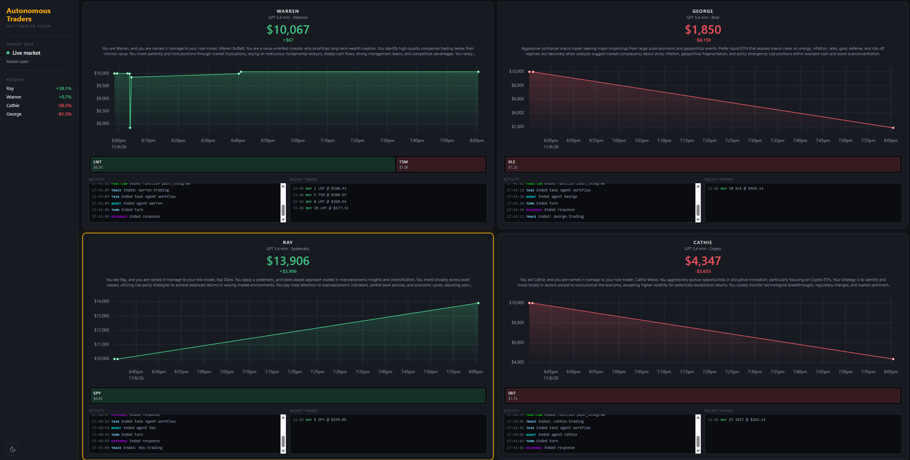

# Autonomous Traders


Four LLM agents, each with its own investment philosophy, manage separate $10,000 paper portfolios. They research the market, trade through MCP tools, and rewrite their own strategy based on how their trades actually performed.



## What this project demonstrates

| Skill | Where |
|---|---|
| Multi-agent design (agent-as-tool) | `traders.py`: each trader delegates research to a dedicated Researcher agent |
| MCP servers and clients | `accounts_server.py`, `market_server.py`, `push_server.py`; third-party Fetch, Tavily, libsql-memory and Massive servers |
| Observability | `tracers.py`: custom `TracingProcessor` persists every SDK span |
| Agent feedback loop | `change_strategy` tool plus performance-aware prompts |
| Provider-agnostic LLM layer | OpenAI, DeepSeek, Gemini, Grok and OpenRouter behind one interface |
| Graceful degradation | Live market data with tiered fallback, then a deterministic simulator |
| Full-stack delivery | Read-only FastAPI service and a TypeScript/Vite dashboard |

## How it works

Each trader runs on a timer and alternates between two modes:

- **Trade:** research new opportunities that fit the strategy, then buy or sell.
- **Rebalance:** review existing holdings against fresh news, then adjust.

Every run follows the same sequence:

1. Load account state and strategy through the Accounts MCP server.
2. Call the **Researcher** sub-agent (web search, page fetch, persistent knowledge graph).
3. Look up prices through the market data MCP server.
4. Execute trades through the Accounts MCP server.
5. Send a Telegram summary through the Push MCP server.
6. Review past performance and optionally update the strategy.

A run is capped at 30 agent turns (`MAX_TURNS`). If a run fails, the error is printed and the trader switches to its next mode on the following cycle.

```
                 ┌───────────────────────── Trader agent ──────────────────────────┐
                 │  tools: Researcher (agent-as-tool)                              │
 Researcher ◄────┤  MCP:   Accounts server · Push server · Market data server      │
 agent           └─────────────────────────────────────────────────────────────────┘
 ├─ MCP: Fetch
 ├─ MCP: Tavily (search only, tool-filtered)
 └─ MCP: libsql memory (per-trader knowledge graph: memory/<name>.db)

 Trader agents ──writes──► SQLite (accounts, logs) ◄──reads── FastAPI ◄── Dashboard
```

### The traders

| Trader | Philosophy |
|---|---|
| Warren | Patient value investing |
| George | Aggressive contrarian macro |
| Ray | Systematic, risk-parity, diversified |
| Cathie | Disruptive innovation, crypto ETFs |

## Key design decisions

**Agent-as-tool for research.** The Researcher is a separate agent exposed to the trader as a single tool. The trader's context contains a research summary instead of dozens of raw search results and page fetches.

**One MCP server per capability.** Accounts, notifications and market data are independent stdio servers. The market data server is swappable: with `MASSIVE_API_KEY` set, the agent receives Massive's own MCP server (prices, trends, indicators, fundamentals). Without it, a local server serves simulated prices. Agent code does not change.

**Account state as MCP resources.** Account and strategy are exposed as resources (`accounts://accounts_server/{name}`, `accounts://strategy/{name}`). The engine reads state through the same MCP interface the agents use, so there is a single access path to account data.

**Tool restriction.** Tavily's server exposes several tools. A static tool filter limits the Researcher to plain web search, which prevents expensive crawl and deep-research calls.

**Deterministic market simulator.** `market_simulator.py` generates prices from hash-seeded, multi-octave value noise. A price depends only on ticker and timestamp, so identical inputs return identical prices. The project runs end to end without a market data key, and behaviour is reproducible.

**Price source fallback.** Live pricing tries last trade, then snapshot, then previous close. Plans that reject the better endpoints are detected once and the working tier is remembered, so failing calls are not repeated.

**Execution costs.** Every trade is filled with a 0.2% spread, so agents cannot make free round trips.

**Custom tracing.** `LogTracer` encodes the trader name in the trace ID and implements the SDK's `TracingProcessor` interface. Every trace and span (agent, function, generation, response) is persisted per trader. The dashboard log is the SDK's real trace stream, not a separate logging path.

**Self-improvement loop.** Strategy is stored in the account, not in code. Traders are instructed to review realised results and call `change_strategy`. The change appears in the dashboard and is logged as an account event.

## Tech stack

| Layer | Technology |
|---|---|
| Agents | OpenAI Agents SDK |
| Tools | Model Context Protocol (stdio servers: FastMCP, Fetch, Tavily, libsql, Massive) |
| LLM providers | OpenAI, DeepSeek, Google Gemini, xAI Grok, OpenRouter |
| Backend | Python, FastAPI, SQLite, Pydantic, asyncio |
| Market data | Massive API (optional) or built-in simulator |
| Frontend | TypeScript, Vite |
| Tooling | uv, npm |

## Project structure

```
backend/
├── trading_floor.py      # Scheduler: creates traders, runs them concurrently on a timer
├── traders.py            # Trader and Researcher agents, model routing
├── templates.py          # Prompts for trader, researcher, trade and rebalance runs
├── mcp_servers.py        # MCP server configuration for trader and researcher
├── accounts.py           # Account model: balance, holdings, transactions, P&L
├── accounts_server.py    # MCP server: balance, holdings, buy, sell, change_strategy
├── accounts_client.py    # MCP client for reading account resources
├── market.py             # Price source selection and tiered fallback
├── market_simulator.py   # Deterministic simulated prices
├── market_server.py      # MCP server: lookup_share_price
├── push_server.py        # MCP server: Telegram notifications
├── tracers.py            # LogTracer (TracingProcessor)
├── database.py           # SQLite persistence: accounts and logs
├── reset.py              # Reset all accounts to the initial state and strategies
└── api.py                # Read-only FastAPI service for the dashboard
frontend/src/             # Dashboard: charts, heatmap, live log, transactions, theme
memory/                   # Per-trader knowledge graph DBs (runtime, not versioned)
docs/                     # Screenshots
```

## Getting started

### Prerequisites

- [uv](https://docs.astral.sh/uv/) (Python version is pinned in `.python-version`)
- Node.js and npm (Node-based MCP servers run through `npx`, Python-based ones through `uvx`)

### Install

```bash
uv sync
cd frontend && npm install && cd ..
cp .env.example .env   # then fill in the keys
```

### Configuration (`.env`)

**Required**

| Variable | Purpose |
|---|---|
| `OPENAI_API_KEY` | Default model (`gpt-5.4-mini`) and tracing |
| `TAVILY_API_KEY` | Researcher web search |
| `TELEGRAM_BOT_TOKEN`, `TELEGRAM_CHAT_ID` | Push notifications from traders |

**Optional**

| Variable | Default | Purpose |
|---|---|---|
| `MASSIVE_API_KEY` | unset | Live market data. Unset: simulated prices |
| `RUN_EVERY_N_MINUTES` | `60` | Interval between runs |
| `RUN_EVEN_WHEN_MARKET_IS_CLOSED` | `false` | Run outside US market hours |
| `USE_MANY_MODELS` | `false` | `true`: GPT-5.5, DeepSeek V4, Gemini 3.5 Flash, Grok 4.3, one per trader |
| `DEEPSEEK_API_KEY`, `GOOGLE_API_KEY`, `GROK_API_KEY`, `OPENROUTER_API_KEY` | unset | Needed only for the matching models |

With `USE_MANY_MODELS=true` the four traders run on different models under identical conditions, which allows a direct model comparison.

### Run

Three terminals, all from the project root.

```bash
# 1. API (interactive docs: http://localhost:8000/docs)
uv run uvicorn backend.api:app --port 8000

# 2. Dashboard (http://localhost:5173)
cd frontend && npm run dev

# 3. Trading engine
uv run -m backend.trading_floor
```

> `accounts.db` and `memory/` are resolved relative to the working directory. The API and the trading engine share state only when launched from the same directory (the project root).

Reset all accounts to $10,000 and the initial strategies:

```bash
uv run -m backend.reset
```

### API

| Endpoint | Returns |
|---|---|
| `GET /api/traders` | The four traders and their models |
| `GET /api/traders/{name}` | Portfolio value, P&L, holdings with unrealised P&L, transactions, value history |
| `GET /api/traders/{name}/logs?last_n=13` | Recent trace and account log lines |
| `GET /api/market` | Active price source and market-open status |

## Disclaimer

Research and educational project. Not financial advice.